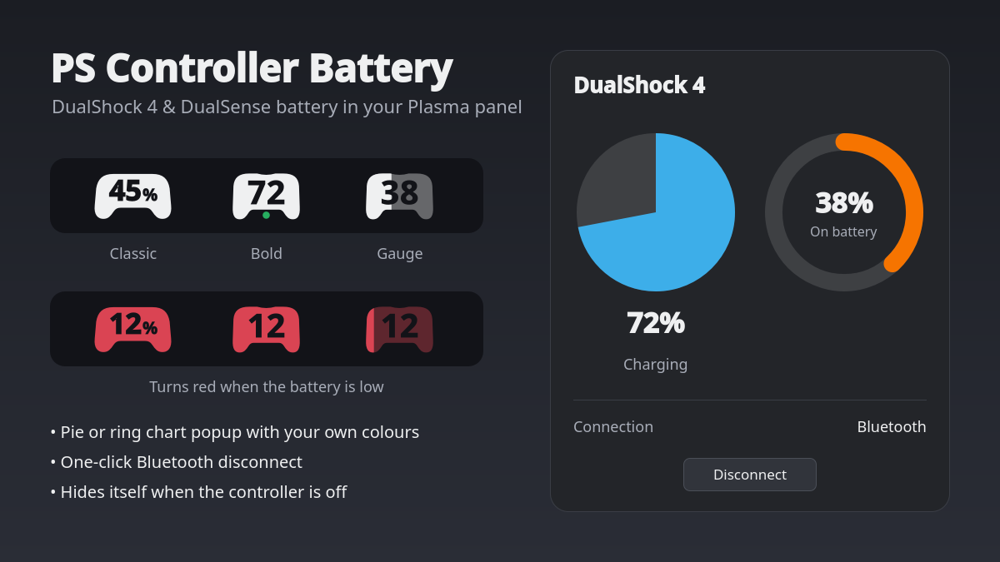
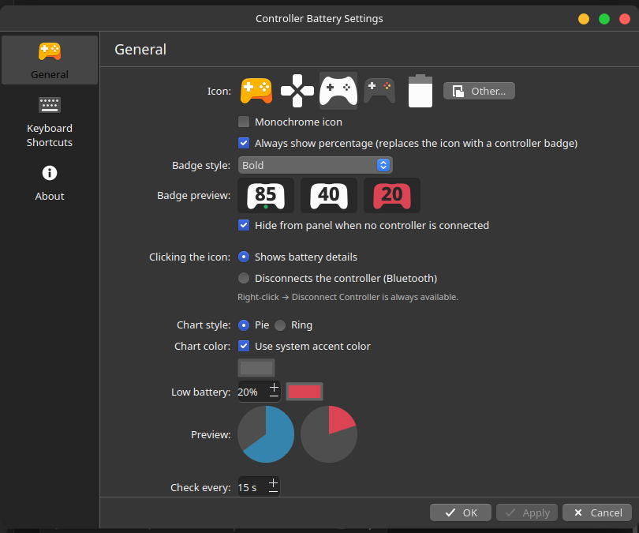

# PS Controller Battery

A KDE Plasma 6 panel widget that shows the battery level of your PlayStation controller (DualShock 4 / DualSense).



## Features

- **Controller badge in the panel.** The percentage is cut out of a controller silhouette so your panel shows through. There are three styles:
  - **Classic:** wide controller with a small `%`.
  - **Bold:** taller body with big digits.
  - **Gauge:** bold, and the body fills up with the charge.
- **Icon mode:** if you'd rather have a plain icon, pick any icon (monochrome or colour). The percentage then appears over it on hover.
- **Popup:** click for a pie or ring chart, charging status, connection type (Bluetooth/USB) and the controller's address.
- **Colours:** choose your own chart colour or use the system accent colour. Set a low-battery threshold and its colour.
- **Bluetooth disconnect:** from the popup, the right-click menu, or optionally by single-clicking the icon.
- **Auto-hide:** hides itself from the panel when no controller is connected.
- A green dot shows while the controller is charging. Middle-click refreshes immediately.



## Requirements

- KDE Plasma 6
- A controller handled by the kernel's `hid-playstation` driver (DualShock 4, DualSense, DualSense Edge) or the older `hid-sony` driver
- `bluetoothctl` (from BlueZ) for the disconnect feature

The widget reads the battery from `/sys/class/power_supply`, so it needs no extra daemons or permissions.

## Install

**From the KDE Store:** right-click the panel → *Add Widgets…* → *Get New Widgets…* → *Download New Plasma Widgets*, then search for **PS Controller Battery**.

**From a release:** download the `.plasmoid` file from [Releases](../../releases), then run:

```sh
kpackagetool6 -t Plasma/Applet -i ps-controller-battery-*.plasmoid
```

**From source:**

```sh
git clone https://github.com/ElectricCowBoy123/plasma-controller-battery.git
kpackagetool6 -t Plasma/Applet -i plasma-controller-battery/package
```

After installing, add **PS Controller Battery** to a panel.

To update an existing install, use `-u` instead of `-i`, then restart Plasma (`systemctl --user restart plasma-plasmashell`).

## Building the .plasmoid

```sh
./build.sh
```

## License

GPL-2.0-or-later
